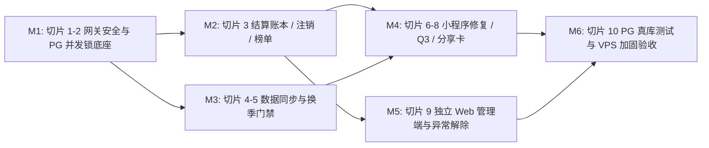

# 赛事预言家：首版上线前全量修复与补齐实施计划（v4.0）

> 状态：**✅ 切片 1–10 全部完成开发、全量功能/逻辑复审（v4.1 31/31 清零）与真实 PostgreSQL 17 终验（`285/285` 测试文件、`3317/3317` 用例 0 skipped 0 failed，`typecheck`/`build`/`vps:preflight` 全部通过）；微信输入框 maxlength 对组合 Emoji 的实机行为待微信开发者工具/真机验收**  
> 生成日期：2026-11-24（进度更新：2026-11-24）  
> 前端 UI 执行约定：本轮仅做保证功能验证所必需的最基础页面改动，不开展视觉设计或统一样式调整；所有页面的完整 UI 由产品在全部切片结束后统一开发。切片 1 已修改昵称字数校验逻辑及移除页面死分支；切片 6–8 已完成小程序首页、榜单/群组/Q3/Q4 与分享卡功能性改造（保留基础样式）；微信输入框 maxlength 对组合 Emoji 的实际行为仍待实机验证。  
> 基线依据：[FIRST_RELEASE_FEATURE_SCOPE__v1.0.md](FIRST_RELEASE_FEATURE_SCOPE__v1.0.md)、[FIRST_RELEASE_SPEC_OVERRIDES__v1.0.md](FIRST_RELEASE_SPEC_OVERRIDES__v1.0.md) 与 Wave 1–4 Code Review 报告（`docs/review/`）

---

## 1. 目标概述（Goal Description）

基于已定稿的首版功能范围与 41 条口径裁决，系统性清零首版上线阻断缺陷与拍板改造项，使项目满足 **VPS 生产环境（PostgreSQL + HTTP 网关 + systemd + Caddy）+ 微信小程序** 完整上线门禁：

- **全量覆盖范围**：**7 条 P0（上线阻断）+ 59 条 P1（高危）+ 23 条 P2（优化）+ 8 条表 B 拍板改造项**。
- **核心架构目标**：
  1. 彻底消除 PostgreSQL `READ COMMITTED` 下先读后整文档覆写引发的并发丢分、群人数突破上限与已解散群复活风险；
  2. 打通网关 DoS 防护、会话 SHA-256 摘要与注销吊销全链路、环境隔离与优雅停机；
  3. 修复 S3 多数据源协同退避阻塞与 S7/Q5 自动换季门禁缺口；
  4. 补齐 Q3 缺失的公开主页、账号注销入口（及待确认的管理 UI）与全部拍板体验改造项（分享卡群聊照抄、首页日期条前后 11 天、游客态模糊占位、默认进首页等）；
  5. 建立基于真实 PostgreSQL（`FOOTBALL_TEST_DATABASE_URL`）的并发集成测试与 WXML 绑定测试门禁。

---

## 2. 关键设计决策状态

### 2.1 已确认决策（Q-PLAN-1 ~ Q-PLAN-4 全部确认完毕）

- **`Q-PLAN-1`（✅ 已确认选 A — 独立轻量 Web 管理页）**：在仓库 `admin/` 目录单独开发轻量 Web 管理前端，由 Caddy 同域 `/admin/`（或独立内网端口）反代，不增加小程序包体积也不影响微信提审；配套简洁的管理员登录/会话鉴权（如由 `scripts/vps-admin.mjs` 签发短期管理会话或管理员口令登录），对接现有 5 个 `/v1/admin/*` 接口及新增的异常解除、审计日志查询、升班马资料维护接口。
- **`Q-PLAN-2`（✅ 已确认选 A — 升班马服务端下发）**：在 `teams` 文档与数据库表增加 `name_zh`、`logo_url`，由 `/v1/matches`、`/v1/predictions/me` 等接口一并返回；小程序优先使用服务端下发中文名与队徽 URL（保留本地 114 张 PNG 作为离线优先缓存）；同步新升班马缺映射/缺中文时写入持久化异常提醒运营补全，彻底实现换季零重发小程序。
- **`Q-PLAN-3`（✅ 已确认 — 分享卡 `share_token` + 自动预填跟单）**：
  - 复用 `FOOTBALL_MATCH_CURSOR_SECRET` 对 `(user_id, league_id, season_id, round_id)` 生成**确定性 HMAC 签名 `share_token`**（群里转发的老卡片长期有效、无需改数据库表；未持有效 `share_token` 直接调 `GET /v1/share-card/{user_id}` 仅返回已截止/已结算场次，防扒排行榜大神作业）；
  - 群友点未开赛卡片“去预测/跟一单”跳转 `match-detail` 时，**自动预填分享者的主客比分**到输入框。
- **`Q-PLAN-4`（✅ 已确认 — 首页日期条前后 11 天）**：日期条范围扩展为 `今天 - 11 天` 到 `今天 + 10/11 天`（可横向滑动），**进首页默认选中并自动滚动聚焦到“今天”**，同步更新 `docs/design/scripts/verify-home-migration.py` 旧断言。

### 2.2 待最终确认项

- **无**（全部 `Q-PLAN-1 ~ Q-PLAN-4` 设计决策已由产品确认完毕，待下达启动指令后按第 3 节的 **10 个交付切片** 依次执行）。

---

## 3. 分批实施路线图（M1–M6 / 10 个交付切片基准）



### 3.1 执行切片总表（基准顺序）

> 按“先底座安全与并发、再核心交易与换季、后小程序交互与管理 UI、最后真库压测与上线加固”的顺序推进；**每完成 1 个切片即运行对应单测与 `typecheck`，确认通过后再进入下一切片**。

| 所属阶段 | 切片编号 | 切片名称 | 核心交付范围 | 切片验收门禁 | 当前状态（2026-11-24） |
|---|---|---|---|---|---|
| **M1 底座** | **切片 1** | **网关安全、环境隔离与会话摘要** | `A-S1-01/03/04/05/08/09/10`、`D-S1-01`、`A-S8-06~11/15(Caddy)` | `typecheck` + 网关/auth/preflight/config 单测全过 | 已由外部工具开发完成（本轮未复审；组合 Emoji 微信实机待验） |
| **M1 底座** | **切片 2** | **PostgreSQL 行锁与并发防丢更新** | `A-S4-01/02`、`A-S5-01/02/03/07`、`A-S8-14` | `typecheck` + PG schema/doc-db/settlement/groups 单测全过 | 已由外部工具开发完成（本轮未复审；见下方遗留待办） |
| **M2 核心** | **切片 3** | **结算账本、注销联动与等级/榜单修复** | `A-S1-02`、`A-S4-03~09`、`D-S4-01/06`、`A-S5-04/05/11/12/13`、`A-S8-02/04/05/12/13` | `typecheck` + S1/S4/S5/S8 后端单测全过 | 已由外部工具开发完成（本轮未复审） |
| **M3 同步** | **切片 4** | **S3 多源同步与调度可靠性** | `A-S3-01~14`、`D-S3-01` | `typecheck` + `src/provider/*`、`src/jobs/*`、`src/runtime/*` 单测全过 | **已完成开发与审核**（`tsc` 0 err；57 passed / 1 skipped `tick.pg.test.ts`，876/876 非 PG 用例通过） |
| **M3 换季** | **切片 5** | **S7 / Q5 自动换季与收官门禁** | `A-S7-01~04, 07~11`、`D-S7-02/04`、`Q-PLAN-2` | `typecheck` + S7 领域/应用/API 单测全过 | **已完成开发与审核**（`tsc` 0 err；S7/Q5/Q-PLAN-2 专项 22 文件 287/287 passed；注：`A-S7-11` 已并入切片 6） |
| **M4 前端** | **切片 6** | **小程序启动页、首页与预测链路** | `D-S1-06`、`A-S1-06/07`、`A-S2-01~07`、`D-S2-04`、`A-S7-05/06/11`、`Q-PLAN-4` | `matches` / `match-detail` / `my-predictions` / `session` 测试全过 | **已完成开发与审核**（`tsc` 0 err；32 文件 567/567 passed） |
| **M4 前端** | **切片 7** | **小程序榜单、群组与 Q3/Q4 缺口** | `A-S5-06~10/14`、`D-S5-03/04`、`A-S6-01~08` | `rankings` / `groups` / `profile` / `settings` / `unlocks` / `public-profile` 测试全过 | **已完成开发与审核**（`tsc` 0 err；31 文件 439/439 passed；`A-S6-04` 与 `share-card` 429 归口切片 8 完成） |
| **M4 前端** | **切片 8** | **分享卡群聊照抄改造** | `D-S1-03`、`D-S6-01`、`Q-PLAN-3` | `share-card` 前后端测试 + `share_token` 防偷窥用例全过 | **已完成开发与审核**（`tsc` 0 err；8 文件 195/195 passed） |
| **M5 运维** | **切片 9** | **Q3 独立 Web 管理端与异常解除** | `A-S8-01`、`A-S8-03`、`Q-PLAN-1` | Admin API / 审计 / `admin/` 前端构建与鉴权测试全过 | **已完成开发与全量复审（含 v4.1 31/31 清零）** |
| **M6 验收** | **切片 10** | **PG 真库并发测试与 VPS 加固总检** | `A-S8-15`、`D-S3-07`、全量 `*.pg.test.ts` 与 WXML 绑定测试 | `typecheck` + `build` + `npm test`（含 PG 真并发）+ `vps:preflight` 0 skipped 全过 | **已完成开发与真库终验（PG 17：`285/285` 文件、`3317/3317` 用例 0 skipped 0 failed，`vps:preflight` 0 err）** |

---

### Milestone 1（M1）：P0 网关安全、凭证哈希与 PostgreSQL 并发锁底座

> 覆盖：`A-S1-01/03/04/05/08/09/10`、`D-S1-01`、`A-S4-01/02`、`A-S5-01/02/03`、`A-S8-06~11`、`A-S8-14`。

1. **HTTP 网关与 Caddy 安全加固**（`src/gateway/http.ts`、`ops/vps/Caddyfile`、`src/gateway/assemble.ts`）：
   - `new URL(req.url, ...)` 与 `parseQuery` 移入 `try/catch` 消除畸形 URL 崩进程 DoS（`A-S1-01`）；
   - `readJsonBody` 限制 256KB 上限并销毁超限流，`Caddyfile` 配 `request_body { max_size 256KB }`、`header_up X-Real-Ip {remote_host}`、屏蔽公网 `/health`、加安全响应头与 `transport http` 超时（`A-S1-03/05`、`A-S8-08/15`）；
   - `InMemoryRateLimiter` 加 Map 容量上限；补齐 `POST /v1/auth/wechat`、`GET /v1/share-card/{user_id}`、`GET /v1/league-seasons`、`GET /v1/profiles/:user_id`、`/v1/groups*`、`/v1/admin/*` 限流与 `assertUnknownFields` / `405` 校验（`A-S1-04/08/10`）；`admin-anomalies.ts` 先鉴权再限流（`A-S1-09`）；对齐 `openapi.yaml`；
   - `SIGTERM`/`SIGINT` 优雅停机（`closeIdleConnections()` + `await closeResources()`）；`vps-runtime.ts` 的 `healthCheck` 加 1.5s TTL 缓存。
2. **环境隔离与 Pool 健壮性**（`src/gateway/config.ts`、`src/gateway/repository-factory.ts`、`scripts/deploy-preflight.mjs`、`scripts/vps-db.mjs`）：
   - 禁止 `prod + memory` 启动；强校验 `dev/test/prod` 与 PG `schema`/`namespace` 隔离（`A-S8-06/10`）；`vps-db.mjs --apply` 生产强制 `--allow-prod`；`deploy-preflight.mjs` 在 `prod` 补 `parseRankingFirstPeriodKey` 与 `pathToFileURL`（`A-S8-11/15`）；
   - `createPostgresConnect` 为借出的 `PoolClient` 挂 `error` 监听并在释放时销毁坏连接（`A-S8-07`）。
3. **凭证摘要化**（`src/infrastructure/postgres-auth-sessions.ts`）：
   - `auth_sessions.token` 改 SHA-256 摘要落库与查询（`D-S1-01`），新增 `deleteByOpenid(openid)`（`A-S1-02`）。
4. **PostgreSQL 行锁与局部字段更新**（`postgres-document-db.ts`、`repositories.ts`、`cloudbase-app-repository.ts`）：
   - 新增事务内 `getForUpdate(collection, id)`（`SELECT ... FOR UPDATE`）与 `patch(collection, id, fields)`（`jsonb_set`），按固定顺序加锁防死锁；
   - `ProfileMutationService`、`WeeklyLevelEvalService`、`LevelCorrectionReevalService`、`PeriodFinalizeService`（`A-S5-02`）、`AdminResultCorrectionService`/`ProviderResultSyncService`（`A-S4-02`）全部改行锁 + 局部更新，禁止跨职责整文档覆写（`A-S4-01`）；
   - `GroupsService` 事务内锁 `users` 与 `groups`，捕获 `uk_group_user` 转 `409 GROUP_ALREADY_MEMBER` 并带 `details.group_id`（`A-S5-01/07`）；
   - `RebuildPeriodRankingsService` 与 `AdminRebuildRankingsService` 将 `rankingPeriodLockKey` 移至 `withTransaction` 外部（`A-S5-03`）；
   - PG `null` 过滤改为 `(${expr}) IS NULL`，未声明字段过滤类型对齐，`applyPostgresSchema` 加 `pg_advisory_xact_lock` 与索引定义漂移检测（`A-S8-14`）。

#### 切片 2 遗留问题与验收待办（✅ 已在 v4.1 与切片 10 全部闭环并真库验证）

- [x] 确认 `driftedIndexes` 在运维检查及应用入口清晰展示，索引漂移只报告，不自动删除或重建。（`CR-01` + `postgres-schema.pg.test.ts`）
- [x] 核对并发初始化时 `created` 报告的归属准确性；执行前后状态差异不能证明对象由当前调用创建。（`CR-13` + `postgres-schema.pg.test.ts` 4 并发真库验证）
- [x] 对项目实际使用的索引核对定义归一化，特别是 `ASC`、`NULLS FIRST/LAST` 等差异是否会被错误忽略。（`CR-02` + `postgres-schema.pg.test.ts` 非默认空值排序漂移真库验证）
- [x] 在隔离 PostgreSQL 上定向验证并发初始化、漂移报告与不重建，以及封板和结算、等级评估交叉竞争；完成后清理本次测试使用的临时容器。（`slice10-pg-acceptance.pg.test.ts` 真库通过，临时 PG 17 容器已清理）
- [x] 完成上述检查后再对切片 2 做独立审核和整体定向验收。（已在 v4.1 复审与切片 10 全量 285/285 真库验收中闭环）

---

### Milestone 2（M2）：结算账本、一致性、等级、榜单与账号注销闭环

> 覆盖：`A-S1-02`、`A-S4-03~09`、`D-S4-01/06`、`A-S5-04/05/11/12/13`、`A-S8-02/04/05/12/13`。

1. **结算与审计**：`retry-settlement-target.ts:121` 起点改 `firstSettlementVersion`（`A-S4-03`）；三个结算服务写 `Failed` 事务首行加 `renewSettlementLockForFinalize` 围栏（`A-S4-07`）；`RetrySettlementService`/`CorrectionSettlementService` 将 `auditWriter` 移入事务内部（`A-S8-02`）；`settlement-timer` 隔离阻塞异常防止新完场饥饿（`A-S4-09`）。
2. **账号注销全链路**：`deleteMyProfile` 联动吊销 `auth_sessions`（`A-S1-02`）、退出所有群并扣减 `member_count`（`A-S5-05`）、禁用同 `openid` 活跃 `admins`（`A-S8-04`）。
3. **等级、周榜与一致性**：统一周榜注销保留累加值（仅 `global_rank = null`）与 `deleted_at < periodEndAt` 口径（`A-S4-04`、`A-S5-04`）；修正重评以 `is_level_frozen !== true` 判定并对齐回放（`A-S4-05`、`D-S4-01`）；`replayLevel` 读 `initialState`；每日一致性按引用分批拉取老用户 `matches`、跳过 `failed` 修正单并同步写非阻塞 `anomalies`（`A-S4-06`、`D-S4-06`）；对齐 5 处租约墙钟与周期任务防跳过（`A-S4-08`、`A-S5-12`）；`GET /v1/rankings` 先鉴权后校参、`scope=group&board=season` 游标封堵历史季（`A-S5-11`）。
4. **管理接口与脚本规范**：`vps-admin.mjs` 改 `parseArgs({ strict: true })`（`A-S8-05`）；`admin.ts` 校验 `reason.trim()`、撞锁用 `RANKING_REBUILD_ALREADY_RUNNING`（`A-S8-12`）；`findAnomalyPage` 下推 PG 分页（`A-S8-13`）。

---

### Milestone 3（M3）：S3 数据同步可靠性与 S7 自动换季（Q5 门禁）

> 覆盖：`A-S3-01~14`、`D-S3-01`、`A-S7-01~04, 07~11`、`D-S7-02/04`。

1. **S3 多源同步与调度**：`football.env.example` 更新为 `fd,5d,of,bsd,sp`（`D-S3-01`）；非权威副源禁改状态/作废（`A-S3-01`）；`ProviderResultPending` 不触发全局 30m 退避（`A-S3-02`）；改期继承 `prediction_closed_at`、禁合并 `Live`、校验 `round_id`、取代后 `resolveEffectiveMatch`（`A-S3-03/04`）；单联赛隔离、`5d` 失效按 tick 降级、`KeyPool` 持久化 `quotaResetAt` + WAF 403 冷却（`A-S3-05/06/07`）；`stale_recovery` 下推 `superseded_by: null`、`post_finish_verify` 持久化每日兜底、僵死 `running` 收敛、`MaintenanceCleanup` 禁删关键 `provider_snapshots`、`fd` 回退 `source_league_ref` + `MAX_PAGES`（`A-S3-08~14`）。
2. **S7 / Q5 自动换季与收官门禁**：
   - `FootballDataAdapter` 过滤 `stage === "REGULAR_SEASON"`（`A-S7-02`、`D-S7-02`）；
   - `evaluateLeagueSeason` 移除 `"abandoned"` 终态并校验 `regular_*_score`（`A-S7-03`）；
   - `CloudBaseAppRepository.findByUserAndCanonicalMatchIds` 按 `prediction_id` 索引（`A-S7-04`）；
   - `LeagueSeasonMaintenanceService` 加锁与周期门控、改 `findByLeagueSeason` 并填充 `ended_at`（`A-S7-07/11`）；`leagues/status` 限近赛季投影与缓存（`A-S7-08`）；`PersonalLeagueSummaryService` 补年份与错误码校验（`A-S7-10`）；
   - **Q5 闭环（`A-S7-01` + `Q-PLAN-2`）**：增加相邻季（6 月新季/7 月旧季补赛）赛程探测；副源缺映射写持久化异常并提供入库命令；`Team` 增加 `name_zh`/`logo_url` 由接口下发；更新 `docs/OFFSEASON_OPERATIONS_CHECKLIST__v1.0.md`（`D-S7-04`）。

---

### Milestone 4（M4）：小程序端全量修复、Q3 缺口补齐与拍板改造

> 覆盖：S1/S2/S5/S6/S7 小程序全部缺陷、`D-S1-03/06`、`D-S2-04`、`D-S5-03/04`、`D-S6-01`、`A-S6-01~08`、`A-S7-05/06/11`。

1. **启动与首页（`D-S1-06`、`A-S1-06/07`、`A-S2-01~07`、`D-S2-04`）**：`app.json` 第 0 页改 `pages/matches/matches`；公开读服务补 `auth: "optional"`；`session.js` 复位 `loading`；`matches`/`match-detail` 补异常捕获/竞态与幂等键清理；`prediction-query.ts` 对齐 `Settled` 与版本；`mapTeam` 缺资料降级不崩整页；首页已截止未开球加“大家怎么选 ›”；日期条扩为前后 11 天（默认定位今天）；休赛期跳赛季榜去掉 `levelSeasonId`、游客小结显示 `guest` 引导登录、默认联赛限定 `ACTIVE_PHASES`。
2. **榜单与群组（`A-S5-06~10/14`、`D-S5-03/04`）**：`rankings.wxml` 绑定 `listTitle` 与 `listItems`、去掉“已封榜”、渲染 `guestBars` 模糊占位并隐藏 Tab；周一选“本周”保留；`presentItem` 预计算 `Array.from(...)[0]`；修复群组邀请码去空格、单页栈 `navigateBack` 兜底、`requestSerial`/`loginGeneration` 与 401/409 处理。
3. **Q3 缺口与分享卡改造（`A-S6-01~08`、`D-S1-03`、`D-S6-01`）**：
   - 新增 `pages/public-profile/*` 与 `getPublicProfile` 并在榜单/群榜行绑定点击跳转；
   - `pages/settings` 补强二次确认“注销账号”入口；
   - `profile.wxml` 补解锁记录入口、`profile.js` `clearIdentityPatch` 递增 `favoriteTeamRequestId`、`settings` 补 401/409、`unlocks.wxml` 改中文“重试”+ 去登录；
   - **分享卡群聊照抄改造**：后端校验 `share_token`、注销用户返 `200 + "已注销用户"`、有权限时返回全轮单场预测真实明细；前端背景统一为 `/assets/images/baseline-pitch.webp`，以 `settledCount > 3` 切换完整汇总+战绩标题 vs 仅身份+晒预测标题，移除 `pendingCount` 提示，下方展示单场真实明细与一键跳转 `match-detail` 预填比分，补全 `onShareTimeline()` 与 `429` 态。

---

### Milestone 5（M5）：Q3 异常解除闭环与独立 Web 管理端（`A-S8-01` + `A-S8-03`）

1. **后端补齐**：新增 `POST /v1/admin/anomalies/:anomaly_id/resolve`（必填 `reason` + 事务审计）；`AdminResultCorrectionService` 自动 resolve 赛果类阻塞异常；新增只读 `GET /v1/admin/audit-logs`、升班马资料/映射维护接口，以及独立 Web 管理端登录/会话鉴权接口（复用 `admins` 表鉴权）。
2. **独立 Web 管理前端（`admin/` + Caddy `/admin/` 反代）**：覆盖异常查看与手动解除、赛果修正表单、重试结算、用户统计重建、排行榜重建、升班马团队映射/中文名/队徽维护、只读审计日志。

---

### Milestone 6（M6）：PostgreSQL 真库并发测试、VPS 加固与上线验收

1. **自动化测试补齐**：在 `FOOTBALL_TEST_DATABASE_URL` 下跑通全部 `*.pg.test.ts`（目标 0 skipped），新增 PG `READ COMMITTED` 真并发结算/群组/封板测试、注销闭环测试、S3/S7 边界测试及 WXML 模板绑定测试。
2. **VPS 运维加固（`A-S8-15`、`D-S3-07`）**：缩短 `football-jobs.service` `TimeoutStartSec=150`、任务单元 `FOOTBALL_PG_POOL_MAX=5`；错峰 `football-periodic.timer`（`*:01/15:00`）；`football-api.service` 补依赖与资源限额；更新 `ops/vps/README.md`（补 `periodic` 与 `chmod 600` 指引）。
3. **最终验收命令**：
   ```bash
   npm run typecheck
   npm run build
   FOOTBALL_TEST_DATABASE_URL="postgres://..." npm test
   FOOTBALL_ENVIRONMENT=prod \
   FOOTBALL_LEVEL_FIRST_EVAL_AS_OF=2026-08-03T02:00:00.000Z \
   FOOTBALL_RANKING_FIRST_PERIOD_KEY=2026-W31 \
   npm run vps:preflight
   ```
