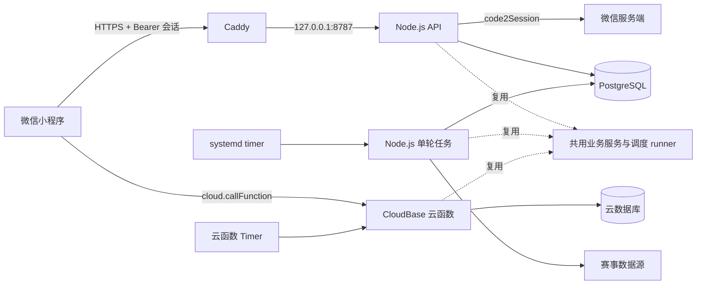

# 自建 VPS / 腾讯云 CloudBase 双部署开发文档 v1.0

> 状态：待评审、待开发；本文件不代表生产部署已经完成。
> 代码核对基线：`2b75280`，仓库 `/home/football`。编写时工作区干净，当前分支 `feat/resource-point-opt`。
> 目标：同一份代码完整支持自建 VPS + 备案域名、腾讯云 CloudBase 两种部署方式；两端均能独立运行并通过功能验收，自建环境不依赖 CloudBase。
> 用户确认的执行要求：聚焦功能性，忽略防御性、安全性、健壮性专项；节点只跑相关功能测试与 typecheck，全部开发完成后统一做全量测试。
> 技术建议：保留 TypeScript/Node.js 与现有业务层；采用 PostgreSQL 持久化，systemd 管理 API 和定时任务，Caddy 提供 HTTPS。
> 本次交付仅为开发与部署方案。数据库选型、会话协议、建议路径和新增命令均是本方案设计，不是当前已有功能。后续实现可继续按用户指定的 OpenCode + Grok 4.6 执行，主 agent 独立复核实际结果。

## 1. 范围、前提与完成定义

### 1.1 本期范围与执行约束

- 同一代码库支持两条完整部署路线，按配置选择，不维护两套计分、结算或排行榜业务逻辑。
- 自建：微信小程序经备案 HTTPS 域名访问 Node.js API，wx.login/code2Session + 自建会话，PostgreSQL 持久化，systemd 调度。
- CloudBase：小程序继续通过 wx.cloud.callFunction 调用云函数，使用可信 context.OPENID、云数据库和云函数 Timer；补齐与自建相同的后台业务功能。
- 两端均覆盖用户、比赛、预测、赛果、首次/更正结算、群组、等级、周榜及 career/strength/season 榜单、任务状态与资源点优化。
- 自建首期单 VPS、单 API 进程；不引入 Redis、消息队列、Kubernetes、多实例或高可用架构。
- **只聚焦功能性。**防御性编程、安全加固、健壮性专项、攻击/越权测试、压力/并发极限测试、故障注入、断网断电恢复演练不列入本期开发任务或验收门槛。已有相关实现不主动拆除，也不借迁移扩展加固。
- 微信身份识别、HTTPS 平台要求、正常会话使用、持久化、业务唯一约束、计分和结算一致性属于功能本身，仍须实现；只验证业务需要的正常行为，不扩展专项设计。
- **节点内只运行本节点及受影响模块的相关功能测试与 typecheck**；测试依赖 dist 时先 build。禁止每完成 VPS01、VPS02 等节点就跑全量测试。
- **全部开发节点的代码完成后统一做全量测试**，再进行两端真实环境功能验收。修复发现的问题时先跑对应测试；共用代码修复后，在最终交付前统一确认全量结果。
- 数据迁移、备份及回滚仅保留必要操作说明，不开发复杂容灾系统，也不以故障恢复演练阻塞功能交付。
- **数据库适配先覆盖现有业务真实调用到的查询与端口组合**，未被业务调用的操作符或端口后置，遇到再补；不为“完整对齐端口语义”预先实现用不上的组合。
- 数据迁移/导出工具不在本期默认交付内；确认存在需要搬迁的旧数据后再开发（见 §10.1）。

### 1.2 环境前提

用户已选择“自建 VPS + 已备案域名”。生产域名用 `api.example.com` 表示，必须替换成实际域名；历史演示域名不作为生产地址承诺。

上线前需要：目标 VPS、SSH 访问方式、实际域名、可配置的 DNS、有效备案与接入信息、小程序 AppID/AppSecret、至少一个可用的赛事数据源。本文以境内 VPS 配合有效备案接入为部署前提，具体备案/接入要求由服务商和微信后台审核结果确认。

**区分三个问题：**域名能否备案、已有备案域名能否加入微信白名单、服务器位于哪里，是不同层面的条件。不能仅凭“解析到境外 IP”就断言某个已备案域名永远不能加入微信白名单；微信官方网络文档要求的是域名经过 ICP 备案。本文不采用“先备案再随意改变接入”的部署操作。

小程序本身的备案、服务类目、隐私保护指引和发布审核也需在微信后台完成；配置服务器域名不等于获得发布资格。AppSecret 仅配置在服务器，不进入小程序包、Git、日志或本文。

### 1.3 完成定义

自建环境和 CloudBase 环境分别以两名真实微信用户完成：登录 → 比赛列表 → 提交预测 → 查看我的预测 → 赛果同步 → 首次及更正结算 → 等级与排行榜更新，并验证群组、管理员正常操作、周榜封存及全部快照任务。

两端均使用真实持久化存储；小程序分别以体验版完成实际请求，自建体验版关闭域名校验豁免。同一受控 fixture 在两端的计分、等级及榜单结果一致，全部开发完成后的全量测试通过，才可标记“双部署功能支持完成”。只保留 CloudBase 入口或通过云函数 build 不算 CloudBase 功能验收通过。

双部署指两种可选、可独立部署的运行模式，不包含跨环境实时同步、自动切换或同一生产账本由两端同时处理。不同环境可以同时运行各自独立的数据；切换同一生产环境时单独安排数据迁移。缺少任一端真实环境凭据时，应明确标记该端“代码验证完成、真实环境待验收”，不能标记整体完成。

## 2. 现有代码事实与缺口

| 模块 | 实际位置 | 当前行为 | 本期工作 |
|---|---|---|---|
| 小程序传输 | `miniprogram/services/api.js:90` | `trial/release` 强制 `cloud`；HTTP 已有 `wx.request` | 允许正式环境 HTTPS HTTP transport；统一加入会话凭证 |
| 客户端身份检查 | `miniprogram/services/api.js:34` | 禁止 body/query 中 `openid/user_id/token` | 保留业务身份字段禁令；凭证由网络层放入 Authorization |
| 昵称初始化 | `miniprogram/services/session.js` | 直接 POST `/v1/session/init`，body 为昵称 | 初始化之前完成微信登录；保持业务接口昵称合同 |
| 应用启动 | `miniprogram/app.js` | 现有会话恢复和云模式初始化 | 区分 transport；HTTP 不要求云环境，恢复服务端会话 |
| HTTP 入口 | `src/gateway/http.ts:68` | 支持注入 CloudBaseDb；默认内存模式装载种子；进程内限流 | 新增生产装配、读取凭证、健康检查及资源关闭 |
| 网关身份 | `src/gateway/identity.ts` | prod 返回 null，dev/test 可用 mock | 在 HTTP 信任边界验会话，再向业务层注入 openid |
| 网关路由 | `src/gateway/assemble.ts` | 已接受 `trusted_openid`；业务服务可复用 | 接收验证后的身份；不信任客户端自报 openid |
| 仓储配置 | `src/gateway/config.ts`、`repository-factory.ts` | 后端只识别 `memory/cloudbase` | 新增 `postgres`；生产禁止内存与 mock 回退 |
| 业务仓储 | `src/infrastructure/cloudbase-app-repository.ts` | 完整 AppRepository 基于文档端口实现 | 保留业务方法，通过自建文档适配层复用 |
| 数据库端口 | `src/infrastructure/cloudbase-db.ts` | get/add/update/query/count/transaction，以及范围、集合、计数端口 | PostgreSQL 适配覆盖业务实际调用的组合，未用到的后置 |
| 数据结构 | `src/schema/collections.ts`、`indexes.ts` | 集合、字段、业务唯一键、查询索引已经定义 | 生成自建表与索引；新增会话表 |
| 生产装配 | `src/cloud-function/runtime.ts` | 强制 CloudBase 配置/SDK；Provider、配额、Timer 在这里接线 | 抽出共享 runtime，保留原云入口，增加 VPS 入口 |
| 资源统计 | `src/infrastructure/db-op-counter.ts` | 统计端口调用并透传查询能力 | VPS 继续使用；不将端口调用数说成 SQL 次数 |
| 结算扫描 | `src/application/settlement-timer.ts` | 待办查询、失败重试、12 小时兜底游标 | 全量复用并持久化 scheduler_state |
| 登录规范 | `docs/H4_AUTH_OPENAPI_DEV_PLAN__v1.0.md`、`src/api/v1/openapi.yaml` | 旧合同明确不签发 JWT/Cookie/session token | 显式登记自建模式的新认证合同，同步合同测试 |
| 发布脚本 | `package.json` | 有 CloudBase 命令，无自建数据库/任务命令 | 增加 VPS 命令和部署模板 |

现有内存种子网关只能用于演示。能返回比赛列表或 HTTPS 200，不能证明已实现真实登录、持久化和自动结算。本文不把历史全量测试记录当作本方案实现后的验收结果。

## 3. 目标架构与技术选择



API 与任务使用同一数据库、同一业务仓储、同一命名空间。API 处理用户请求，单轮任务处理同步与结算。任务无需经公网 HTTP 触发。

### 3.1 推荐 PostgreSQL 的原因

本项目已有文档式仓储，直接重写全部业务仓储成本较高；但 UnitOfWork 又明确要求事务内 savepoint：某个结算 item 失败时撤销该 item 的写入，而不污染外层事务。PostgreSQL 可以通过真实事务和 SAVEPOINT 满足该语义。

首期建议“每个集合一张表 + JSONB 文档 + 表达式索引”的适配方式，复用现有仓储。暂不改成完整关系模型，也不重写计分、结算、排行榜业务。

| 备选 | 收益 | 本项目的代价 | 决策 |
|---|---|---|---|
| PostgreSQL + JSONB 文档适配 | 原生事务/savepoint；可复用文档仓储 | 需要日期编解码、查询翻译、索引生成 | 本文推荐 |
| MongoDB | 文档模型接近现状 | 事务需要副本集；没有 SQL 式 savepoint，需重设结算事务边界 | 首期不采用 |
| PostgreSQL 全关系表 + 全新 AppRepository | SQL 模型直观 | 全量重写仓储和映射，改动较大 | 后续按需求演进 |
| VPS API + CloudBase 数据库 | 可少做部分持久化开发 | 仍依赖云数据库和云侧凭据，未达到本文目标 | 不作为本文主线 |

不得直接复用机器上其他项目的数据库账号、库或容器。部署前检查目标环境已有服务，建立独立数据库和账号；是否复用现有 PostgreSQL 实例由资源与权限核对决定。

### 3.2 代码组织建议

以下均为待新增或调整的路径：

```text
src/runtime/application-runtime.ts           共享业务与 Provider 装配
src/runtime/scheduled-jobs.ts                原 Timer 调度逻辑
src/runtime/vps-runtime.ts                   PostgreSQL 连接、配置和关闭
src/infrastructure/postgres-document-db.ts   文档端口适配
src/infrastructure/document-codec.ts         Date/JSONB 编解码
src/infrastructure/postgres-auth-sessions.ts 会话持久化
src/gateway/wechat-login.ts                  微信 code 换取身份
src/gateway/auth.ts                          Bearer 会话校验
src/jobs/tick.ts                             单轮任务 CLI
scripts/vps-db.mjs                          数据库建表（plan/apply）
scripts/vps-admin.mjs                       管理员初始化
miniprogram/services/auth.js                wx.login、会话缓存
miniprogram/utils/auth-storage.js           会话缓存读写
ops/vps/football-api.service                API unit 模板
ops/vps/football-jobs.service               单轮任务 unit 模板
ops/vps/football-jobs.timer                 10 分钟调度模板
ops/vps/Caddyfile                           专用站点片段
ops/vps/football.env.example                无真实凭据配置模板
```

CloudBase 是与 VPS 并列的正式交付模式，保留并补齐现有云入口和全部业务接线；VPS 启动链不加载 wx-server-sdk 或要求 CloudBase 环境 ID。若保留 `CloudBaseDb/CloudBaseAppRepository` 名称作兼容实现，文档要解释它们是复用的端口/仓储，并不代表连接云服务；不在本期做全仓重命名。

### 3.3 双部署边界与配置选择

| 能力 | 自建 VPS | 腾讯云 CloudBase | 共用部分 |
|---|---|---|---|
| 小程序传输 | transport=http，gatewayOrigin 为 HTTPS 域名 | transport=cloud，配置实际云环境及函数名 | 页面、业务 API 合同、响应归一化 |
| 可信身份 | wx.login → code2Session → 自建会话 → trusted_openid | 云函数 context.OPENID → trusted_openid | 用户初始化与业务用户映射 |
| 数据库 | repository_backend=postgres | repository_backend=cloudbase | AppRepository、业务 schema 与唯一约束 |
| 调度 | systemd 每 10 分钟启动单轮 CLI | 云函数 Timer 每 10 分钟触发 | 到期判断、业务 runner、状态和统计摘要 |
| 配置依赖 | PostgreSQL、微信 AppID/AppSecret、VPS 配置 | 实际 CloudBase 环境/namespace、云端部署凭据 | 数据源、联赛、业务固定配置 |
| 构建发布 | build + VPS 模板 | cloudfunction:build + 现有 provision/deploy/verify | 同一代码版本与业务测试 |

每个运行入口只加载所选模式的依赖。CloudBase 不要求 PostgreSQL、自建登录会话表或 VPS AppSecret；VPS 不要求云环境 ID/云数据库凭据。切换小程序 transport 时走对应登录流程，不能让 cloud 请求依赖自建 Bearer。

§7.3 的所有后台业务必须同时登记并接线到两端；只抽取原 Timer 的 7 项不足以完成双部署。原生 CloudBase 不具备的 SQL 机制不要求机械照搬，需保持对应业务结果一致。后续新增共用业务功能也须接入两种适配。

## 4. 微信登录与自建会话合同

### 4.1 流程

1. 用户完成现有昵称/隐私界面流程。
2. `auth.js` 调用 `wx.login()` 得到一次性 code。
3. 小程序 POST `/v1/auth/wechat`，body **只包含** `{ "code": "一次性微信登录code" }`。
4. VPS 调用 `https://api.weixin.qq.com/sns/jscode2session`，参数为 appid、secret、js_code、grant_type=authorization_code。
5. 微信返回成功 openid 后，服务端创建随机、不透明的会话凭证；不把 AppSecret/session_key 下发。
6. 客户端存储会话，调用原 POST `/v1/session/init`，body 仍是 `{ "nickname": "昵称" }`，网络层加入 Authorization。
7. 后端校验会话后，把 openid 放入 `handleGatewayRequest` 的 `trusted_openid`，继续使用原 SessionService 和业务服务。

微信 code 只能消费一次。微信返回 errcode、超时或网络异常时，不得创建会话或使用 mock 用户兜底；重新登录需重新获取 code。这里不需要先获取微信 access_token。

### 4.2 新增接口

**POST `/v1/auth/wechat`**：公开登录交换端点，独立于业务初始化；成功返回 HTTP 200：

```json
{
  "data": {
    "access_token": "<服务端生成的不透明随机凭证>",
    "token_type": "Bearer",
    "expires_at": "<UTC ISO 时间>"
  },
  "request_id": "<请求 UUID>"
}
```

该示例是拟议合同，未实现。使用简单的不透明随机会话凭证，保存对应 openid 与过期时间，供正常请求解析身份。有效期由 `FOOTBALL_SESSION_TTL_SECONDS` 配置（建议 7 天），过期重新 wx.login。首期不实现 refresh token、会话撤销、多设备会话管理或凭证安全专项。

- 登录失败统一返回 401 `UNAUTHORIZED`，小程序提示用户重新登录即可；不新增专用错误码，也不为上游超时/频控单列合同测试。
- 不将原始微信响应、带 secret 的 URL 或 code 写日志。

**不新增 `/v1/auth/logout`。**自建模式的“退出登录”只需小程序清除本地会话缓存，服务端会话按过期时间自然失效；不做撤销接口。

### 4.3 两种模式的身份接线

- 自建模式由服务端正常校验会话并提供 trusted_openid；CloudBase 继续从云函数 context.OPENID 提供 trusted_openid。
- 登录后沿用现有用户初始化、昵称、我的预测和管理员正常业务流程。两名用户分别看到各自资料和预测。
- 自建退出登录只清除本地缓存，服务端会话按过期失效；账号注销沿用现有业务流程。CloudBase 不新增一套自建 token 登录。
- 正常会话过期后重新登录即可；首期不开发 refresh token、多设备会话管理、专项防护或复杂凭证恢复机制。

### 4.4 与旧规范的冲突处理

旧 H4 规范中的“后端不签发 session token”是 CloudBase 可信运行时方案的历史约定。用户本次选择自建部署，需要正式引入外部 HTTP 认证层。实施前先同步：

- 当前唯一业务基线 `docs/MVP__v2.0.md`：修改技术部署与身份合同，业务计分/赛季规则保持；`docs/MVP__v1.0.md` 已归档，只读保留，不回写。
- `docs/H4_AUTH_OPENAPI_DEV_PLAN__v1.0.md`：保留历史范围说明，标注 VPS 模式替代合同和本文件链接。
- `src/api/v1/openapi.yaml`：新增 `POST /v1/auth/wechat`，描述外部不透明 Bearer；保留内部 trusted_openid 语义，不再宣称整个系统没有 token。不新增 `/v1/auth/logout`。
- `src/api/v1/openapi-auth-h4.test.ts`：由“禁止任何凭证方案”改为核验“客户端不能自报身份、VPS 凭证必须经后端验证”。

此处属于本方案提出的协议变更，不可只删掉旧断言而不更新合同。

## 5. 小程序改造

### 5.1 配置

保留现有其他配置字段；HTTP 部署所需字段示意：

```javascript
transport: "http",
gatewayOrigin: "https://api.example.com",
```

`http` 是现有传输模式的名字，线上请求仍必须是 HTTPS。

- 修改 `api.js:93` 的 trial/release 限制：允许 `http`，但 origin 必须为有效 `https://` 域名。
- 不因切到 HTTP 强行初始化 `wx.cloud`，不要求 cloudEnvId/cloudFunctionName。
- HTTP transport 的所有方法统一携带 Authorization；POST JSON 的 content-type 与凭证同时存在。
- 业务请求使用配置的 gatewayOrigin 和现有 API path；本期不新增跨源凭证校验专项。
- `api.js` 保持现有响应归一化字段 data/statusCode/code/message/request_id/details，页面无需重写。

### 5.2 双模式登录与正常会话恢复

- 自建：昵称提交前调用 ensureAuth，再调用原 initSession；auth 登录请求与业务请求分开，避免登录递归。
- 自建缓存会话及到期时间；正常启动恢复已有会话，过期后重新 wx.login，退出登录即清除缓存。
- CloudBase：保留 wx.cloud 初始化、callFunction 与原有会话流程，不调用自建登录交换，不要求自建 token。
- 保留现有昵称、隐私界面、USER_DELETED 页面语义和预测幂等业务行为。
- 定向测试两种 transport 的登录、初始化、读写和正常过期重登；不开展重试风暴、跨源凭证攻击、多页面并发登录或断网恢复专项。

### 5.3 微信后台配置

1. 登录对应 AppID 的微信公众平台。
2. 进入「开发/开发管理 → 开发设置 → 服务器域名」。
3. `request 合法域名` 增加 `https://api.example.com`，只填 origin，不填 `/v1`。
4. 如真实使用 wx.uploadFile、wx.downloadFile、wx.connectSocket，再分别配置对应域名；不要把 request 白名单当作它们的通用白名单。
5. 不将 `api.weixin.qq.com` 加入小程序合法域名，微信登录交换仅由后端发起。
6. 重新获取开发者工具项目配置，关闭“不校验请求域名、TLS、HTTPS 证书”，重新编译/上传体验版。
7. 检查小程序后台 AppID 与服务器登录交换使用的 AppID 一致。

**纠正旧讨论中的端口说法：**微信官方允许 HTTPS 合法域名配置端口，但配置与请求必须精确一致。本文统一使用标准 443，域名和客户端 URL 均不显式填写 `:443`，不采用额外端口。合法域名不能填公网 IP 或 localhost；使用已备案的具体子域名。

## 6. PostgreSQL 持久化设计

### 6.1 表与索引

建议数据库 `football`、schema `football_prod`，测试用隔离 schema/数据库。命名空间从部署配置加载，沿用统一映射。

每个现有逻辑集合对应一张表，基本结构为 `_id text primary key`、`document jsonb not null`。文档 `_id`、确定性复合 ID、snake_case 和 schema_version 与现有仓储保持一致。表名使用现有物理集合别名或由统一注册表映射，不能由各调用方各自拼接。

- 以 `COLLECTION_DEFINITIONS` 为业务表清单，不能只建 users/matches/predictions。
- 以 `UNIQUE_INDEXES/QUERY_INDEXES` 为索引事实来源，翻译 JSONB 表达式索引，保留多字段顺序与 desc。
- 包含 users、deleted_openid_mappings、teams、team_provider_mappings、match_provider_mappings、matches、match_results、predictions、settlements、settlement_items、user_season_stats、rankings、board_snapshots、groups、group_members、unlocks、level_history、admins、admin_audit_logs、anomalies、sync_logs 等业务集合。
- 运行态表覆盖 provider_usage、provider_key_state、provider_league_state、scheduler_state，以及限流所需存储；具体字段以现有 store 实现为准，不依据本段列表手写一套新模型。
- 新增 `auth_sessions` 表；会话查找键唯一，expires_at、openid 可查询；正常请求按到期时间判断是否需要重新登录。建表脚本幂等即可，不引入版本化迁移框架。
- 迁移命令输出预期/已有/待建对象差异；显式 apply 才落库。

### 6.2 适配端口语义

**范围：先实现现有业务真实调用到的组合。**以下表格是这些端口应有的语义参考，不是要求一次性补齐所有操作符与端口。开发时以实际调用点为准（现有仓储、运行态 store、结算流程），未被业务调用的组合先不实现，遇到缺失再补；补的时候按同样语义对齐即可。

| 端口 | PostgreSQL 实现要求 |
|---|---|
| get | 主键读取，不存在返回 null |
| add | INSERT；主键/业务唯一冲突映射 CloudBaseDuplicateKeyError，再由原仓储映射 UniqueConstraintError |
| update | 只做字段合并；不替换整份文档，不存在抛对应缺失错误 |
| query | 支持等值、null、Date、inFilter、lteFilter、排序、limit/offset；语义对照现有适配器 |
| count | 数据库 COUNT，不先取回所有文档 |
| inFilter/lteFilter | 返回中立的内部查询描述，由 SQL 适配器编译；不接受客户端任意操作符/SQL |
| reserveCounter | 原子保留额度，达到上限返回 false；避免查询后独立更新 |
| adjustCounter/getCounter | 按现有配额 store 的规则实现，支持事务内调用 |
| transaction | 独占 pool client 上 BEGIN/COMMIT/ROLLBACK；异常回滚且释放连接 |
| 嵌套 transaction | 使用同一连接上的真实 SAVEPOINT/ROLLBACK TO/RELEASE，满足仓储 savepoint 合同 |

SQL 使用常规参数化查询和统一表映射。JSONB 中数值、布尔值不能按文本排序；日期保存为规范 UTC ISO，在比较/排序表达式中使用一致类型。不新增 SQL 注入攻击测试或额外校验框架。

**日期编解码必须显式实现。**现有业务大量调用 Date.getTime()。JSONB 读回不能把 Date 永久降为字符串；基于 schema date 字段和运行态 store 字段恢复 Date，包括嵌套 level_state 的日期、可空值。不得把所有长得像 ISO 的普通业务字符串都变成 Date。

**PostgreSQL 保存点功能验证。**当前 `CloudBaseAppRepository.savepoint()` 会调用数据库 transaction；SQL 适配器要检测已处于事务并创建保存点，不能简单 `return work(this)`。必须用真实数据库证明：外层写 A、内层写 B 后失败，回滚 B、外层继续写 C，最后 A/C 存在而 B 不存在。

**功能验证范围。**事务实现以现有 UnitOfWork、唯一约束与结算合同为准，验证正常提交、业务异常回滚、保存点局部回滚、重复结算不重复加分。首期不增加默认 SERIALIZABLE + 自动重试框架、死锁/故障注入或多连接并发专项。发现正常功能确需某种数据库处理时，按实际问题做最小实现。

CloudBase 适配继续使用平台事务完成业务；SQL 保存点仅是 PostgreSQL 适配要求，不要求云 SDK 模拟同名机制。若现有 CloudBase 事务行为影响正常结算，修复对应业务路径，以同一 fixture 的实际结果验收。

### 6.3 工厂与 store 装配

- `GatewayRuntimeConfig.repository_backend` 新增 `postgres`，增加自建数据库配置；postgres 模式不要求 CloudBase environment ID。
- 现有 CloudBaseAppRepository 对配置类型有云环境字段依赖：调整为中立命名空间配置或加明确的本地构造入口；不得伪造一个云环境 ID 通过校验。
- `CloudBaseProviderUsageStore/KeyStateStore/LeagueStateStore/SchedulerStateStore` 主要依赖文档端口，可复用；逐一验证它们的事务和计数能力。
- `CloudBaseWxRateLimitDatabase` 留在云适配；VPS 首期单 API 进程保留现有 InMemoryRateLimiter，不开发共享限流或多实例支持。
- `createCountingDb()` 继续包装完整端口；inFilter/lteFilter/计数功能透传不能再次丢失。
- JobLockRepository 的 acquire/renew/isHeldBy/release 必须经真实数据库原子操作验证，保留 owner 与租约围栏行为。

## 7. 双部署任务与资源点优化

### 7.1 抽取方式

从 `src/cloud-function/runtime.ts` 提取业务装配和 `runDueProviderJobs` 到共享 runtime，不把完整云 handler 用假 SDK 包装后搬进 VPS。云入口和 VPS 入口分别提供配置/数据库/触发参数，共用调度与业务服务。

新增 `src/jobs/tick.ts`：加载配置和数据库 → 创建同一套仓储/Provider → 执行一轮 → 输出摘要 → 关闭连接 → 退出。按 CLI 参数区分生产执行、只读计划和测试 fixture；不得将生产任务开放为匿名公网 endpoint。

### 7.2 保留的执行行为

每 10 分钟触发一次，复用原逻辑判断任务是否到期：

1. post_finish_verify。
2. live_match。
3. near_match。
4. future_schedule，按 due league 调度。
5. full_schedule_verify，按 due league 调度。
6. provider_reconcile，保留原到期间隔判断。
7. settlement，独立于 Provider 配额和未配置数据源情况执行。

保留：延期 next_attempt_at、重试分类、锁内二次资格检查、续租/owner 围栏、同轮缓存、批量映射读取、变化才写、待办结算、12 小时兜底游标、timer_summary 和按集合 db_ops。

**不要双重上同一把锁。**Provider 业务自身已有任务锁；外层若加跨 tick 排他锁，必须使用单独 key 或 systemd 单 unit 不重入，避免外层持锁导致内层永远 skipped。

### 7.3 补齐调度清单

原 Timer 的上述调用不等于覆盖全部应用服务。还需核对 `src/domain/enums.ts` 的 SyncJobType、`src/sync/config.ts`、原同步规范/触发器文档及以下服务，建立“服务 → 频率 → 参数 → 持久化进度 → 是否已接线”表：

- `PeriodFinalizeService`：按小时枚举已结束且未封存周榜，复用 domain/time，停机后能补上遗漏周期。
- `board-snapshot.ts`：career/strength/season 快照、赛季终榜。复用现有频率和赛季边界，不能统一塞成每 10 分钟全量重建。
- 每日一致性检查相关服务：按原规范确认入口和频率；若当前没有接线，应作为独立缺口显式记录，不宣称已经存在。

已核对 `src/sync/config.ts`、`src/scheduler/triggers.md` 和 `SyncJobType`，开发必须覆盖下表，而不是只迁移原 Timer 的 7 项：

| 任务 | 现有规则/入口依据 | VPS 接线要求 |
|---|---|---|
| future_schedule | prod 6 小时，test 12 小时；按联赛 due | 保留 registry 和主备源规则 |
| full_schedule_verify | 24 小时 | 复用完整赛程校验 |
| near_match | 30 分钟 | 复用窗口及延期规则 |
| live_match | 3 分钟 | 受下述 10 分钟入口采样限制 |
| post_finish_verify | prod 3 分钟，test 5 分钟 | 受入口采样限制；首次结算前规则保留 |
| provider_reconcile | runtime 中 24 小时判定 | 复用 reconcile 状态和日志 |
| settlement | 每轮入口执行待办；12 小时兜底 | 不依赖 Provider 成功 |
| period_finalize | 1 小时 | 枚举未封存周，调用 PeriodFinalizeService |
| daily_consistency | 24 小时 | 调用 daily-consistency-service，差异报警，不静默修账本 |
| weekly_level_eval | 周一 02:10 UTC；as_of 为 02:00 UTC | 复用 weekly-level-eval；成功后立即刷新 strength，不重复分发 |
| level_correction_reeval | `settlement-orchestration-service.ts` 已接线至 level-correction-reeval | 迁移时保留现有更正重评调用链并验证完成后的执行；不能仅等每日任务，也不另建重复消费者 |
| board_snapshot_career | 60 分钟（固定配置） | 调用现有 BoardSnapshotService |
| board_snapshot_strength | 24 小时 + 周评估成功后 | 避免一次事件被重复刷新 |
| board_snapshot_season | 60 分钟（固定配置） | 保留正常赛季榜 |
| board_snapshot_season_final | config 中事件式，无固定 interval | 核对 v2 赛季最终快照入口与边界，单独验收，不能用普通 season snapshot 替代 |

**10 分钟入口的实际时效：**本文延续 RP01 已选择的 10 分钟唤醒。因此业务配置虽有 3 分钟间隔，实际最快只能在下一个 10 分钟 tick 执行，延期 1/2/5 分钟同样会等待下一轮；不能宣称仍有 3 分钟直播更新。若要求恢复 3 分钟时效，需另行变更 timer 频率及测试，不能在自建迁移中悄悄改回。周评估等按固定时间判断是否已到期，调度延迟后仍使用原规范 as_of。

小时/每日/每周任务通过持久化 scheduler_state 记录已完成周期，两端共用到期判断与业务时间。保留既有延期、补跑和更正重评行为；首期验证正常周期触发和持久化，不另建事件队列、补偿框架或断电恢复专项。

此清单中每一项的 VPS 与 CloudBase 两端接线，以及赛季终榜核对，都是 VPS07 的交付项。若新旧规范在某项冲突，实施前列出具体差异再确认，不自行猜一个值。小程序实际使用的榜单必须在上线验收中证明可更新。

### 7.4 CLI 与日志合同

建议新增命令（当前尚不存在）：

```bash
npm run jobs:tick -- --dry-run
npm run jobs:tick
```

`--dry-run` 用于打印本轮将执行的任务和到期判断，供上线前人工确认；允许读取数据库与调度状态，但不得写业务账本。不要求实现完整的只读分支（不强制“零外部请求、零状态写入”），运行日志输出到 stdout。真实单轮执行必须输出 timer_summary，区分运行、未到期、延期、无数据源和失败，不能把 skipped 算作真实数据同步成功。

一轮中 Provider 失败仍应尝试独立结算；分别收集错误并在摘要记录。单条比赛失败按原结算语义继续处理其他比赛；若存在本轮真实失败，CLI 非零退出供 systemd 观测，不能仅因顶层 Promise resolved 就返回成功。

VPS 的 db_ops 表示适配端口调用，SQL 语句、事务命令和物理磁盘 IO 另算；不得直接用 CloudBase 资源点口径宣称 VPS 性能收益。

### 7.5 CloudBase 接线交付

- `src/cloud-function/runtime.ts` 通过云数据库适配创建共用业务 runtime；保留 context.OPENID、SDK、云日志和 Timer 事件的原生入口。
- 云 Timer 和 VPS CLI 都调用共用 scheduled-jobs。§7.3 表逐项登记“VPS 入口、CloudBase 入口、触发规则、定向测试、两端验收结果”；不能只完成 VPS 列。
- 云端补齐周期封榜、每日一致性、每周等级评估、各类榜单快照和赛季终榜；已有更正重评链路保留，不重复实现。
- 更新云端 provision 集合/索引（包含 scheduler_state 等实际使用对象）、函数构建文件清单、环境配置和 Timer 声明。
- 共用 runner 用受控 fixture 验证，再分别通过 VPS CLI 和 CloudBase Timer 入口验证调用链；相同业务输入应得到相同结果。

## 8. 配置清单

| 配置 | 当前/新增 | 用途 |
|---|---|---|
| FOOTBALL_ENVIRONMENT=prod | 已有 | 生产模式 |
| FOOTBALL_REPOSITORY_BACKEND=postgres | 值新增 | 选择自建持久化 |
| FOOTBALL_DATABASE_URL | 新增 | 独立 PostgreSQL 连接，凭据只在服务器 |
| FOOTBALL_DATABASE_SCHEMA=football_prod | 新增 | SQL schema 隔离 |
| FOOTBALL_RESOURCE_NAMESPACE=football_prod | 已有，需解耦云校验 | store 命名空间 |
| FOOTBALL_MATCH_CURSOR_SECRET | 已有 | 分页 cursor 签名，长期保持稳定 |
| FOOTBALL_WECHAT_APP_ID | 新增 | 与上传小程序的 AppID 一致 |
| FOOTBALL_WECHAT_APP_SECRET | 新增 | 服务端登录交换 |
| FOOTBALL_SESSION_TTL_SECONDS=604800 | 新增 | 建议 7 天，可调整 |
| FOOTBALL_PROVIDER_SOURCES | 已有 | 只启用有凭据且已验证的数据源 |
| FOOTBALL_SYNC_PROFILE=prod | 已有 | 数据源同步频率/预算配置 |
| FOOTBALL_SYNC_LEAGUES | 已有 | 首期实际同步的联赛 |
| FOOTBALL_PROVIDER_KEY_FD_1 等 | 已有 | 与 sources.ts 的各 source 匹配 |
| FOOTBALL_PROVIDER_MIN_GAP_SECONDS | 已有 | 数据源请求间隔 |

示例模板只放占位符。生产不设置 FOOTBALL_MOCK_TRUSTED_OPENID/FOOTBALL_SEED_SCENARIO，不设置 CloudBase 凭据作为自建路线前提。API 与任务读取同一受控 env 文件；systemd EnvironmentFile 格式不写 `export`，不要把它直接当任意 shell 脚本 source。

Node 版本以实施时受支持的 LTS 为部署目标，并用现有依赖验证、固定精确版本；不要把 package.json 的最低 `>=18` 直接当作长期生产版本建议。

### 8.1 CloudBase 配置与切换

- 小程序 transport=cloud，cloud 环境 ID 和函数名沿用 `miniprogram/config.js` 实际配置键；部署时与实际云环境一致。
- 后端 repository_backend=cloudbase，使用现有 FOOTBALL_CLOUD_ENVIRONMENT_ID、FOOTBALL_RESOURCE_NAMESPACE 及 Provider 配置。
- provision/deploy/verify 的腾讯云凭据沿用现有脚本配置方式；微信身份来自云上下文，不新增 VPS 登录 AppSecret 要求。
- 分别提供 VPS 与 CloudBase 配置示例及部署步骤，并检查各自入口能独立加载；环境选择通过现有 transport/仓储配置完成，不再增加重复的总开关。

## 9. 开发任务与依赖

沿用 VPS01–VPS10 编号便于追踪，但本节交付范围已经升级为双部署。

顺序：VPS01 → VPS02/VPS03 → VPS04/VPS05 → VPS06 → VPS07 → VPS08 → VPS09 → 全部代码完成后的统一全量测试 → VPS10 双环境功能验收。节点内只运行受影响模块的功能测试与 typecheck，依赖 dist 才 build；不在每个节点做全量测试。

### VPS01：冻结双部署合同与配置

- 修改：`docs/MVP__v2.0.md`、H4 文档、`src/api/v1/openapi.yaml`、`openapi-auth-h4.test.ts`、`src/gateway/config.ts` 及配置测试；v1 归档规范不改。
- 工作：明确两种身份来源、数据库和触发器；自建会话合同仅用于 HTTP，保留 CloudBase 原生身份流程。
- 验收：两端分别加载自身配置，均不要求另一端的专属配置；合同测试覆盖两模式。

### VPS02：PostgreSQL 编解码、查询与索引

- 新增：`postgres-document-db.ts`、`document-codec.ts`、对应测试；`scripts/vps-db.mjs`。
- 修改：`package.json/package-lock.json`，新增 pg 及类型依赖。
- 工作：文档 CRUD、日期/排序/过滤、索引注册、plan/apply；复用现有仓储。
- 验收：真实隔离 PostgreSQL 下正常 CRUD、日期往返、in/lte、唯一约束和字段合并通过；共用端口修改同时跑 CloudBase 相关定向测试。

### VPS03：事务、保存点和配额端口

- 修改：VPS02 适配器、仓储配置入口、`repository-factory.ts`，按需调整文档端口内部描述。
- 工作：事务连接、PostgreSQL 保存点、原有额度计数和锁接口，复用完整 AppRepository。
- 验收：正常事务提交/回滚、保存点局部回滚、额度扣减、正常锁获取/释放、重复结算不重复计分；CloudBase 对应业务 fixture 结果一致。不做并发极限或故障注入专项。

### VPS04：自建微信交换与会话存储

- 新增：`wechat-login.ts`、`postgres-auth-sessions.ts`、`auth.ts` 及定向测试。
- 工作：code2Session、会话创建/读取、正常过期重登（退出登录由客户端清缓存完成）。
- 验收：桩微信服务验证登录及会话正常流程；真实微信交换在 VPS10 验收。CloudBase 不依赖这些模块。

### VPS05：HTTP 入口接线

- 修改：`src/gateway/http.ts`、`identity.ts`、`assemble.ts` 及测试；新增 `vps-runtime.ts`。
- 工作：登录路由、会话身份注入、原业务 API、数据库连接和基本健康检查。
- 验收：真实测试库中两个用户分别初始化、读写自己的预测；小程序能读取任务写入的数据；CloudBase 原上下文身份流程的相关测试通过。

### VPS06：小程序双传输与登录

- 修改：`config.js`、`services/api.js`、`services/session.js`、`app.js`、必要会话页；新增 auth/缓存模块。
- 工作：trial/release 支持 HTTPS HTTP；cloud 模式保留云初始化及调用；按 transport 选择对应登录与恢复流程，退出登录清除本地缓存。
- 验收：两模式分别验证登录、初始化、比赛查询、提交预测、我的预测；相关 Node 测试通过，不做凭证攻击和复杂重试专项。

### VPS07：共享 runtime 与两端完整任务接线

- 修改：`src/cloud-function/runtime.ts`；新增共享 runtime、scheduled-jobs、`src/jobs/tick.ts`；按实际依赖调整云函数构建入口。
- 工作：两端共用 Provider/结算/等级/封榜/快照及摘要逻辑；完成 §7.3 与 §7.5 的双端接线表，保留资源点优化。
- 验收：两种入口对相同 fixture 产生相同比赛、账本、等级和榜单结果；所有周期/事件任务均有调用链，重复结算不重复计分，dry-run 能输出计划。

### VPS08：两端初始化工具

- 新增：`scripts/vps-db.mjs`（幂等建表，plan/apply）、`scripts/vps-admin.mjs`（管理员授权）；备份使用现成数据库工具。
- 修改：现有 CloudBase provision/deploy/verify 与集合/索引声明，覆盖新增实际使用对象。
- 不做：数据迁移/导出、孤儿引用检查、唯一冲突报告等搬迁工具。确认存在需要迁移的旧数据后，再按 §10 另行开发。
- 验收：两端空环境均能初始化完整业务数据结构、管理员及必要配置；vps-db 重复执行无破坏。

### VPS09：双部署模板和说明

- 新增：`ops/vps/` 最小可用模板；修改 README/docs 索引的简短入口和 CloudBase 部署说明。
- 工作：VPS API/单轮任务/timer/Caddy 配置；CloudBase 集合索引、函数包、配置及 Timer 发布；两套配置示例。
- 验收：对应模板/脚本与实际入口一致；两端构建产物可生成。此时所有功能代码完成，再执行 §12 的统一全量测试。

### VPS10：双环境真实功能验收

- 前提：全部功能代码完成且统一全量测试通过；两端真实环境、微信配置及必要凭据齐备。
- 工作：按 §13 分别记录 VPS 和 CloudBase 全链路结果，并比较同一业务 fixture 的预期结果。
- 验收：两端各自以两名真实用户跑通体验版、预测、赛果、首次/更正结算、等级、群组、管理员及全部榜单任务；任一端未完成，整体不能标记双部署支持完成。

不按未经验证的“几小时/几天”承诺工期；功能开发和实际环境联通信息明确后再给估计。

## 10. 数据初始化与迁移

### 10.1 先确认数据策略

现有演示网关是内存数据。CloudBase 是否已有真实用户/预测，必须实际盘点，不能从代码或当前未配置凭据推断“没有数据”。

- **新环境起步**：创建独立生产库，导入必要静态配置/球队映射，由真实数据源初始化比赛。不导入 RankAlice/演示预测/虚假积分。
- **保留旧云数据**：只读盘点、导出、校验后迁移。迁移期间暂停旧定时任务及旧写入，导出一致快照，禁止旧云和 VPS 同时结算同一批账本。
- 没有云凭据时，可以完成自建开发与空库验收，但不能声称旧数据已迁移。

本节是数据策略与迁移口径说明。**迁移/导入工具不在本期默认交付范围**：先盘点云端是否真有需要保留的用户与预测，确认有迁移需求后再开发对应脚本，不预先建造搬迁工具。

### 10.2 迁移规则

1. 保留 user_id、openid、业务主键、复合 _id、schema_version、结果版本、结算账本和日期精度。
2. 同一 AppID 的 openid 可延续；不同 AppID 下不能把 openid 视为同一个人自动合并。
3. 同步搬迁 deleted_openid_mappings；不得复活已注销账号或把其预测归入新账号。
4. 保留 predictions、match_results、settlements、settlement_items 及其关联，排行榜可按既有规则重建，但事实账本不能丢。
5. 复制 provider 用量与有效延期状态时按原日期/窗口保留，避免切换后超额请求；旧锁须在旧任务停止后明确清理/等待过期，不能带入永久占用。
6. 新建会话重新登录，不迁移旧开发 mock 身份。
7. dry-run 输出集合计数、孤儿引用、唯一冲突、日期解析问题和迁移计划；发现冲突停下，不自动覆盖。
8. 导入后核对集合计数、抽样关系、结算版本及用户积分账本；验证通过再启用 VPS 任务。

## 11. VPS 部署步骤与模板

以下为**开发完成后的操作合同**，新增脚本和接口当前尚不存在。必须先完成 VPS01–VPS09；不能直接在当前基线复制命令并预期自建能力可用。

### 11.1 目录约定

建议以 `neilxu` 用户运行，避免 root 承载应用：

```text
/home/neilxu/football/releases/<release-id>/  每次构建的独立目录
/home/neilxu/football/current                当前版本软链接
/home/neilxu/football/shared/football.env    仅服务器持有的配置
/home/neilxu/football/backups/               数据库备份及校验记录
```

当前工作仓库仍在 `/home/football`。发布目录是建议新路径，不能将其误报为现有目录；目标机器需先确认用户存在，数据/构建产物属主为 neilxu。不要在正式发布时直接 pull 一个含未提交改动的工作区。

### 11.2 部署前检查

检查当前任务、8787/80/443 占用、数据库资源、Caddy 的实际运行方式和 DNS。先备份已有 football unit、站点片段与配置。仅修改 football 范围，不停止其他 Docker 容器、数据库或共享代理服务。

新版本先在临时本地端口验证。端口参数沿用 startGatewayServer 的 options 或实现配置后启用，不能假设设置 PORT 环境变量当前就有效。

### 11.3 构建与初始化

先在 release 目录以用户身份执行已有构建命令：

```bash
npm ci
npm run typecheck
npm run build
```

数据库 URL 和 schema 通过部署进程受控注入，不能在命令行历史中填写真实连接串。新增脚本应按以下方式运行（待实现）：

```bash
npm run vps:db -- --plan
npm run vps:db -- --apply
npm run jobs:tick -- --dry-run
```

数据库工具须在上线前补入 package.json，支持 plan/apply；管理员授权脚本支持 --dry-run。备份与数据导入使用现成工具，不新增备份脚本；需要迁移旧数据时再按 §10 单独开发。生产首次手动 tick 会调用真实 Provider、消耗额度并写库，只在数据策略与凭据确认后执行。

实现后的最小模板在 `ops/vps/`：`football-api.service`、`football-jobs.service`、`football-jobs.timer`、`Caddyfile`、`football.env.example`、`cloudbase.env.example`。ExecStart 对应当前 `npm run build` 产物 `dist/gateway/http.js` 与 `dist/jobs/tick.js`。CloudBase 操作说明见 `src/cloud-function/DEPLOY.md`。

### 11.4 API systemd 模板

```ini
[Unit]
Description=Football API
After=network-online.target
Wants=network-online.target

[Service]
Type=simple
User=neilxu
WorkingDirectory=/home/neilxu/football/current
EnvironmentFile=/home/neilxu/football/shared/football.env
ExecStart=/usr/bin/node /home/neilxu/football/current/dist/gateway/http.js
Restart=on-failure
RestartSec=5

[Install]
WantedBy=multi-user.target
```

`/usr/bin/node` 必须替换为目标机固定的实际 Node 路径；确认编译产物路径。连接池在 SIGTERM 时关闭，停止接受新请求并收尾，避免依赖强杀。

### 11.5 单轮任务与 timer 模板

```ini
# football-jobs.service
[Unit]
Description=Football scheduled jobs
After=network-online.target
Wants=network-online.target

[Service]
Type=oneshot
User=neilxu
WorkingDirectory=/home/neilxu/football/current
EnvironmentFile=/home/neilxu/football/shared/football.env
ExecStart=/usr/bin/node /home/neilxu/football/current/dist/jobs/tick.js
TimeoutStartSec=1800
```

```ini
# football-jobs.timer
[Unit]
Description=Run Football jobs every ten minutes

[Timer]
OnCalendar=*-*-* *:00/10:00
Persistent=true
Unit=football-jobs.service

[Install]
WantedBy=timers.target
```

同一 oneshot service 运行中不重复拉起。Persistent=true 表示停机错过日历触发后补触发，不代表逐条重放所有漏掉的 tick；业务应从数据库到期状态恢复。任务内部用 UTC 时间存储，业务周/赛季边界复用 domain/time；机器时区不应改变业务归属。

### 11.6 Caddy 站点模板

推荐 Caddy 与 API 同在宿主机，由 Caddy 直连 loopback：

```caddyfile
api.example.com {
    reverse_proxy 127.0.0.1:8787
}
```

DNS A/AAAA 必须解析到目标服务器；有 AAAA 时也要确认 IPv6 可达。80/443 对外可达，使用受信任的有效证书、完整链和 TLS 1.2+。Caddy 自动申请证书仍依赖实际网络和域名验证成功。

若复用**现有容器 Caddy**，容器里的 127.0.0.1 不是宿主机：须使用实际可达的宿主地址，并配置受限的宿主监听/bridge，不能直接复制上面的 upstream。历史环境曾使用 bridge 转发，此文件不固化其 Docker 网段；先核对目标机网络。仅校验并 reload 站点配置，不停止整套 Docker。

### 11.7 切换与启动顺序

1. 在新版本目录完成 build、定向验证和数据库 plan。
2. 备份数据库，应用向后兼容的增量迁移并 verify。
3. 启动临时 API，验证健康检查、比赛查询及实际数据库读写。
4. 若有旧数据迁移，先停旧写入与旧任务，导入并校验。
5. 切换 current 到已验证 release；重新加载 football unit 配置，启动正式 API。
6. 验证本地 8787 和公网 HTTPS，再启用 football-jobs.timer。
7. 微信后台域名与小程序 origin 一致，上传体验版做联合验收。
8. 观察至少一个真实任务轮次及有赛果的结算，记录失败/跳过原因；空赛程不能证明结算已验收。

不得同时启用旧 CloudBase Timer 和新 VPS 任务处理同一套事实数据。

## 12. 验证命令与口径

### 12.1 节点内验证：仅相关测试 + typecheck

按实际修改选择相关测试，以下是命令示例，不要求每个节点都执行全部命令：

```bash
# 仅当所选测试依赖 dist 时先 build
npm run build
npm run typecheck
npx vitest run src/infrastructure/db-op-counter-passthrough.test.ts src/application/settlement-timer.test.ts
npx vitest run miniprogram/services/api.test.mjs
```

新增 PostgreSQL、auth、jobs 模块补充必要的功能测试。调整共用 runtime/仓储/客户端传输时，选择受影响的 VPS 与 CloudBase 定向测试；不运行整个测试库，不把每节点 cloudfunction:build 或全量 build 设为固定门槛。只改文档时检查文档即可。

测试聚焦正常使用和业务正确性，不为安全、防御、健壮性增加专项测试。保留现有测试；全部开发完成后仍由全量测试统一运行，不能为了省事删除既有断言。自动化桩与真实微信/真实云数据库验收分别记录。

### 12.2 全部开发完成后：统一全量验证

仅在 VPS01–VPS09 全部功能代码完成、进入最终联合验收时运行：

```bash
npm run build
npm run typecheck
npm test
npx vitest run miniprogram
npm run cloudfunction:build
```

小程序测试使用 Vitest 递归发现 `miniprogram/` 下的 `.test.mjs`；最终记录实际文件数，确保新增深层目录测试也被包含。

这轮验证覆盖全部 Vitest、小程序测试及两端构建；记录真实文件/用例数、退出码和失败项。失败后先按失败范围修复并定向验证，最终交付前再统一确认受影响的全量结果，不恢复成逐节点全量测试。

### 12.3 两端部署功能验证

自建环境检查实际 API 可访问、数据库读写、单轮任务和 HTTPS：

```bash
systemd-analyze verify ops/vps/football-api.service ops/vps/football-jobs.service ops/vps/football-jobs.timer
systemd-analyze calendar '*-*-* *:00/10:00'
caddy validate --config ops/vps/Caddyfile --adapter caddyfile
curl --fail 'https://api.example.com/v1/matches?status=scheduled'
systemctl status football-api.service football-jobs.timer
journalctl -u football-jobs.service -n 100 --no-pager
```

CloudBase 环境按现有命令准备集合索引、发布函数并核验：

```bash
npm run cloudbase:provision -- --plan
npm run cloudbase:provision -- --apply --allow-prod
npm run cloudbase:deploy
npm run cloudbase:verify
```

上述 --allow-prod 用于现有脚本在 FOOTBALL_ENVIRONMENT=prod 下的建库操作，目标实际使用 dev/test 时可以省略；执行前核对脚本参数和目标环境。这些是开发完成后的部署步骤，本次文档更新不执行云端写入。verify 只证明资源状态，仍须在体验版完成真实请求，并通过实际 Timer 日志和数据库结果验证后台任务。两端数据源额度各自配置，不做跨环境共享额度协调。

## 13. 双部署功能验收清单

| 编号 | 功能场景 | 自建 VPS 通过标准 | CloudBase 通过标准 |
|---|---|---|---|
| A01 | 模式配置与体验版 | http + 备案 HTTPS，关闭调试豁免可访问 | cloud + 实际环境/函数，体验版可调用 |
| A02 | 真实身份与初始化 | code2Session/自建会话，两名用户分别初始化 | context.OPENID，两名用户分别初始化 |
| A03 | 正常会话使用 | 启动恢复、正常过期重登；退出登录清缓存后可重新登录 | 原云会话与初始化正常，不要求自建 token |
| A04 | 用户资料与我的预测 | 两用户各自读写自己的资料/预测 | 两用户各自读写自己的资料/预测 |
| A05 | 比赛与预测 | 列表、详情、截止规则、提交/修改按原业务正确 | 相同功能与结果 |
| A06 | 持久化与业务事务 | PostgreSQL 真实读写、正常提交/回滚 | 云数据库真实读写、正常提交/回滚 |
| A07 | Provider 同步 | 单轮 CLI 正常同步比赛与赛果 | Timer 正常同步比赛与赛果 |
| A08 | 首次结算/重跑 | 正常计分、重复执行不重复加分 | 同一 fixture 结果一致 |
| A09 | 赛果更正 | 更正结算及等级重评链路跑通 | 同一 fixture 结果一致 |
| A10 | 等级与周期 | 周评估、每日一致性、周榜封存可执行 | 相同任务均有实际接线与结果 |
| A11 | 榜单与快照 | 周榜、career/strength/season 及赛季终榜正常 | 相同规则、相同 fixture 结果 |
| A12 | 群组与管理员 | 原有群组及管理员正常操作可用 | 相同功能可用 |
| A13 | 资源点优化 | 保留 in/lte、批量映射、到期/延期及12小时兜底 | 相同优化在实际调用链生效 |
| A14 | 部署与配置独立 | 不要求云环境和云凭据 | 不要求 PostgreSQL 或 VPS 会话配置 |
| A15 | 最终自动化验证 | 全部开发完成后的全量测试通过、VPS 构建可用 | 同轮全量结果通过、云函数包可用 |

已有注销等业务功能继续按原合同使用；不增列攻击/越权、并发压力、故障注入、备份恢复和回滚演练验收。

每项分别填写两端状态，未验收不得空填为通过。记录代码版本、两端环境/命名空间、迁移版本、微信体验版版本、实际命令输出与结果；同一 fixture 对比计分/等级/榜单，真实赛果同步另记实际结果。任一端只有 build 或桩结果时，明确标记真实环境待验收。

## 14. 备份、迁移与回滚操作说明

保留发布前备份和人工切换的必要说明，作为部署参考，不增加备份平台、自动容灾、自动回滚或恢复演练开发任务，也不列为本期功能验收门槛。

- VPS 可使用 PostgreSQL 现成备份工具；CloudBase 沿用平台数据导出能力，需要时再执行。
- 应用版本回退按各部署方式的现有发布工具操作；涉及数据结构或新写入时单独核对实际数据。
- VPS 与 CloudBase 数据不会自动同步；同一生产环境的部署方式切换需要明确数据策略，不能仅改小程序 transport。
- 两端独立环境可同时运行；迁移同一套事实数据时只启用一套写入与结算任务。

## 15. 待落地输入与当前状态

### 15.1 开发可先完成，部署前必须明确

| 项目 | 当前处理方式 |
|---|---|
| 生产备案域名 | 本文使用 api.example.com 占位，部署前替换 |
| 目标 VPS 与 Caddy 拓扑 | 未在本次文档任务中指定，不假定当前演示机器就是生产 |
| 自建数据库选型 | 本文推荐 PostgreSQL JSONB 适配，待方案评审 |
| 旧 CloudBase 真实数据 | 未做云端盘点，迁移与否待实际确认 |
| AppID/AppSecret | 由用户在部署时通过服务器配置提供，不在聊天中索取明文 |
| 首期联赛与数据源 | 沿用现有 sources.ts 配置体系，逐个验证可用性/额度 |
| 周榜/快照/每日检查任务 | VPS07 完成原规范频率及 VPS/CloudBase 两端入口表 |
| 开发执行方式 | 继续采用 OpenCode + Grok 4.6，按阶段独立审查 |

### 15.2 进度

- [x] 核对当前小程序、HTTP 网关、身份、仓储、Timer 与旧规范。
- [x] 写出双部署开发任务、配置、部署与功能验收方案；明确只聚焦功能及最终统一全量测试。
- [x] VPS01–VPS03：合同与真实数据库适配（代码在工作区，未部署）。
- [x] VPS04–VPS06：登录、会话、HTTP 接线与小程序（代码在工作区，未部署）。
- [x] VPS07：共享 runtime，VPS 与 CloudBase 全部后台任务接线（代码在工作区，未部署）。
- [x] VPS08：`scripts/vps-db.mjs` / `scripts/vps-admin.mjs` 与 CloudBase provision 覆盖新增对象（迁移工具仍待确认旧数据后再定）。
- [x] VPS09：`ops/vps/` 最小模板、README/docs 入口、CloudBase 部署说明（模板与入口对齐；未执行部署，未做真实云验收）。
- [ ] 全部功能代码完成后：统一全量测试、小程序测试及两端构建。
- [ ] VPS10：真实 VPS 与 CloudBase 分别完成微信体验版功能验收。

## 16. 依据与相关文档

项目依据：

- [资源点优化开发计划](RESOURCE_POINT_OPTIMIZATION_DEV_PLAN__v1.0.md)。
- [CloudBase 仓储覆盖表](CLOUDBASE_REPOSITORY_COVERAGE.md)，复用端口的事实依据，不代表自建适配器已经完成。
- [H4 旧认证合同](H4_AUTH_OPENAPI_DEV_PLAN__v1.0.md)，需要显式处理的旧约束。
- [项目 v1 主规范](MVP__v1.0.md) 与 [v2 规范](MVP__v2.0.md)。

官方资料（本次查阅）：

- [微信网络与服务器域名规则](https://developers.weixin.qq.com/miniprogram/dev/framework/ability/network.html)：ICP、HTTPS、域名/端口匹配、TLS 与调试豁免范围。
- [微信小程序登录流程](https://developers.weixin.qq.com/miniprogram/dev/framework/open-ability/login.html)：wx.login、一次性 code 与 session_key 不外发。
- [微信 code2Session](https://developers.weixin.qq.com/miniprogram/dev/server/API/user-login/api_code2session)：后端调用、参数和失败语义。
- [PostgreSQL 事务与保存点](https://www.postgresql.org/docs/current/tutorial-transactions.html)：事务及局部回滚功能的依据。
- [MongoDB 事务部署约束](https://www.mongodb.com/docs/manual/core/transactions-production-consideration/)：standalone 不支持多文档事务，作为数据库备选比较依据。
